# Lampstand

Lampstand is a free Bible study web app that helps you read the Bible each day, understand what you read, and read it together with friends.

It's built with Next.js 16, TypeScript, Tailwind CSS 4, and Supabase, and it runs on Google Cloud Run. Every screen follows [DESIGN.md](DESIGN.md).

<p align="center">
  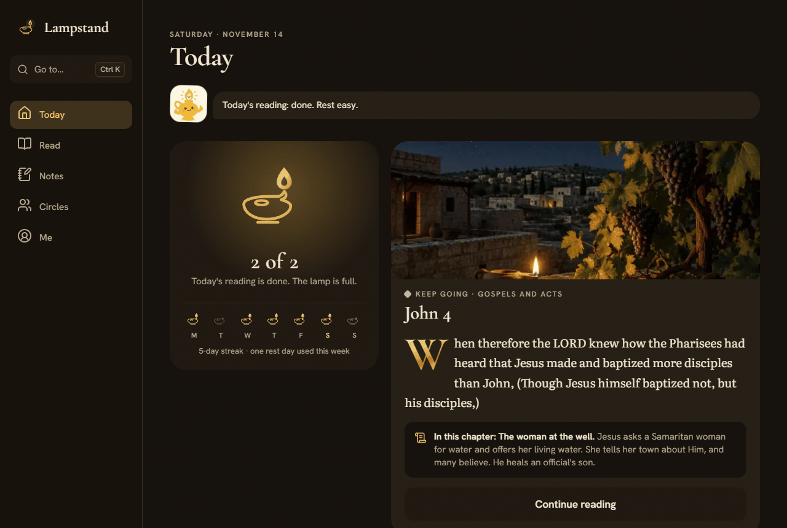
</p>

## Contents

- [What makes Lampstand different](#what-makes-lampstand-different)
- [What it does](#what-it-does)
- [Run it on your computer](#run-it-on-your-computer)
- [Keys and settings](#keys-and-settings)
- [What things cost](#what-things-cost)
- [Supabase setup](#supabase-setup)
- [Bible content and one-time scripts](#bible-content-and-one-time-scripts)
- [Deploying](#deploying)
- [How it works](#how-it-works)
- [Where things live](#where-things-live)
- [Sources and licenses](#sources-and-licenses)

## What makes Lampstand different

- **Words of Jesus in green italics, and words of God in blue.** 2,032 passages of Jesus's words come from the public-domain eBible.org KJV. 3,057 passages where God speaks directly, from "Let there be light" to the voice from heaven, were tagged once with AI. Every passage was checked word for word against the KJV text.
- **A lamp, not a scoreboard.** Your daily reading fills a lamp. Missed days get "Welcome back", never a broken-streak warning.
- **Highlight a whole passage in one move.** Drag across verses, or long-press and drag on a phone. Then share it to your Circle in one tap.
- **Listen and follow along.** Every chapter can be read aloud while the verse being read is underlined. The device voice is free. The natural voice records a chapter once and shares it with everyone, so it costs almost nothing to run.
- **AI that stays with the text.** Summaries, explanations, prayers, songs, and quiz questions come from the KJV text, never from your notes. Bible references are checked against real verse counts, and quiz answers must come word for word from the verse they cite. Wording stays neutral for Catholic, Orthodox, and Protestant readers.
- **A Bible challenge that's fair.** Your Circle can play a live quiz, like a game night. The database keeps the time and the score, so no phone can see an answer early or cheat the clock.
- **Private by design.** Circles are invite-only, with no public profiles and no strangers. Mute and block are built in, and nudges are gentle.
- **Start without an account.** Reading, notes, highlights, Listen, Pray, and Explain all work on your device as a guest. Sign in later to sync.
- **Built for long, comfortable reading.** A thumb-first layout on phones and a warm Night theme without glare. Text contrast is checked by tests, and the whole app works with a keyboard and screen readers.
- **Free to run, on purpose.** Every paid feature has daily limits stored in the database, so one person or one bad actor can't run up the bill.

## What it does

### Read

The KJV is built in, and the NLT and ESV come from their publishers' APIs. Books stand on shelves by kind, and a thin gold bar shows how far you are through the whole Bible.

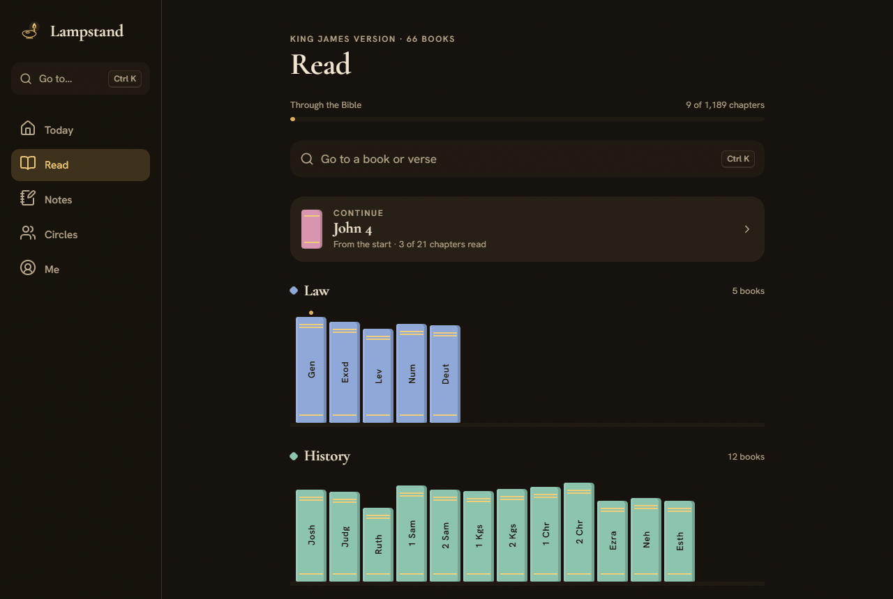

### Words of Jesus and words of God

In the KJV, the words of Jesus show in green italics and the words God speaks directly show in blue. A legend sits above the text, and you can turn the colors off in Text settings.

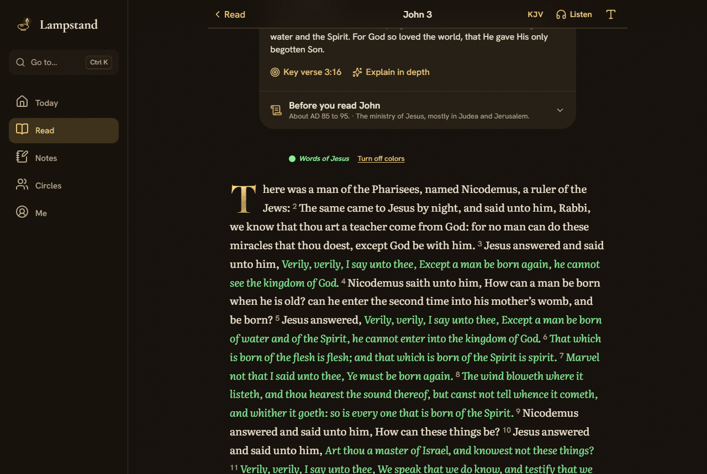

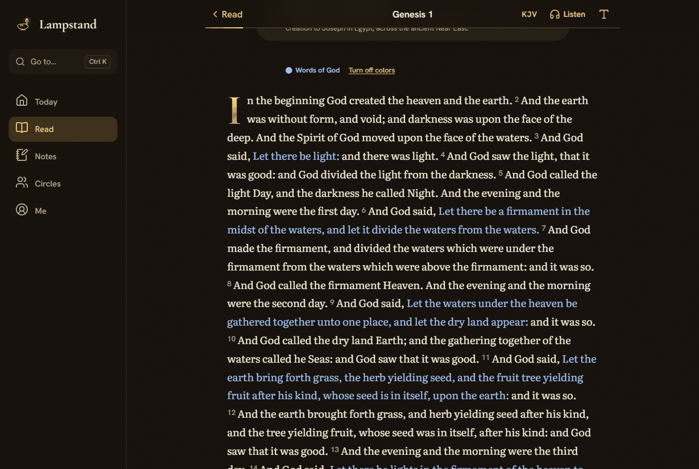

### Highlight several verses and share them

Select verses by dragging, by long-pressing and dragging on a phone, or with **Select more**. Tap a color to highlight them as one passage. **Share** sends the passage to your Circles, with your note and its summary if you choose.

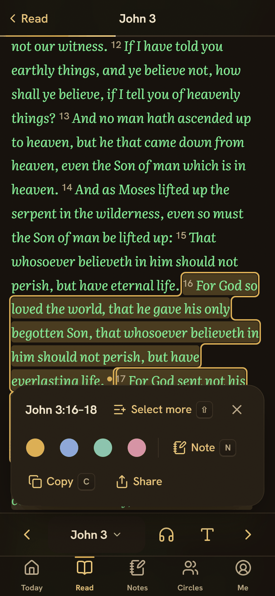

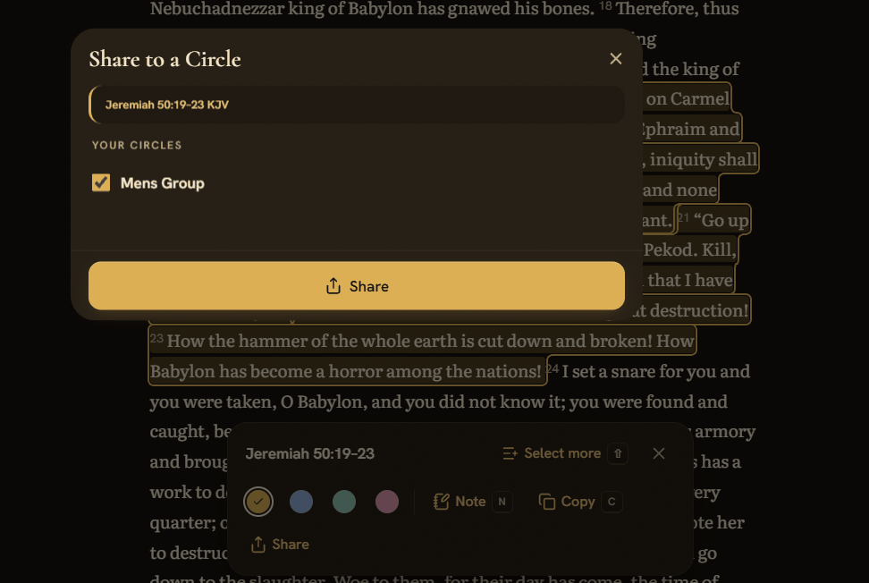

### Listen

**Listen** reads any chapter aloud and underlines the verse being read. Choose the free device voice or the natural voice, change the speed, and skip from verse to verse. The Listen button is always in the bottom bar on phones and the top bar on desktop.

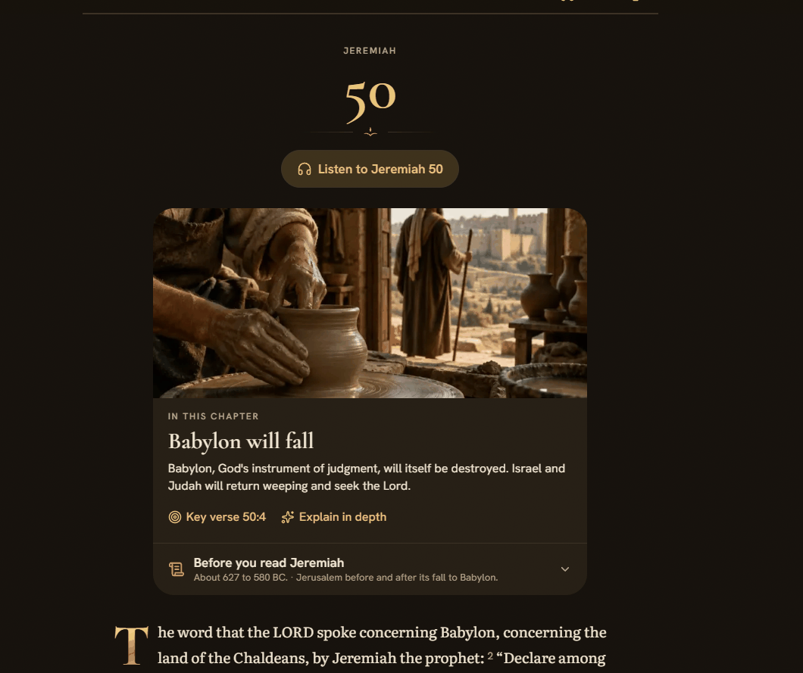

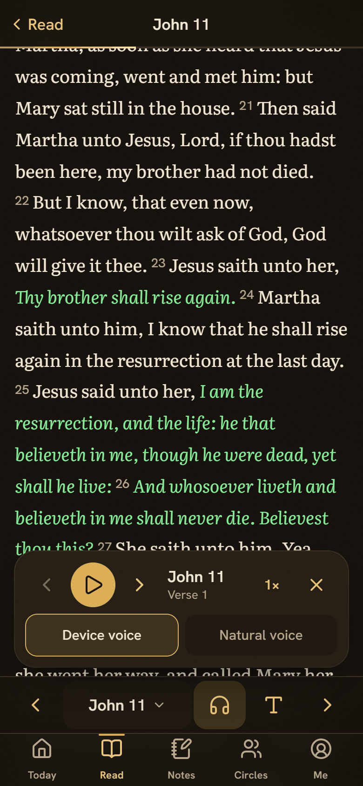

### Notes and highlights

Notes lists your notes and highlights by book. Each highlight shows its KJV words and a short AI summary to help you remember it. Tap a highlight to open the reader with those verses selected.

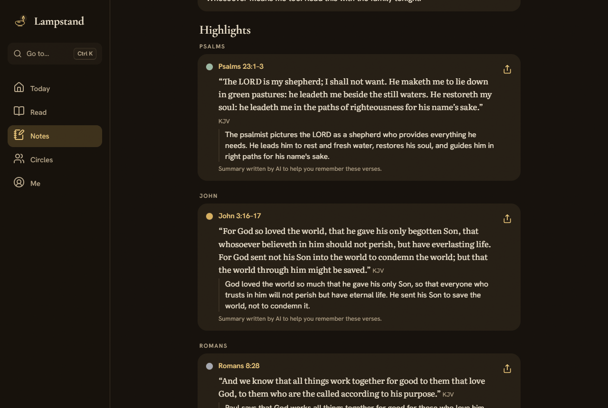

### Understand, pray, and sing

Each chapter has an "In this chapter" note, a "Before you read" context card, and **Explain in depth**. When you mark a chapter as read, the lamp brightens, and you can explain it, pray over what you read, or make a song from it.

<table>
  <tr>
    <td>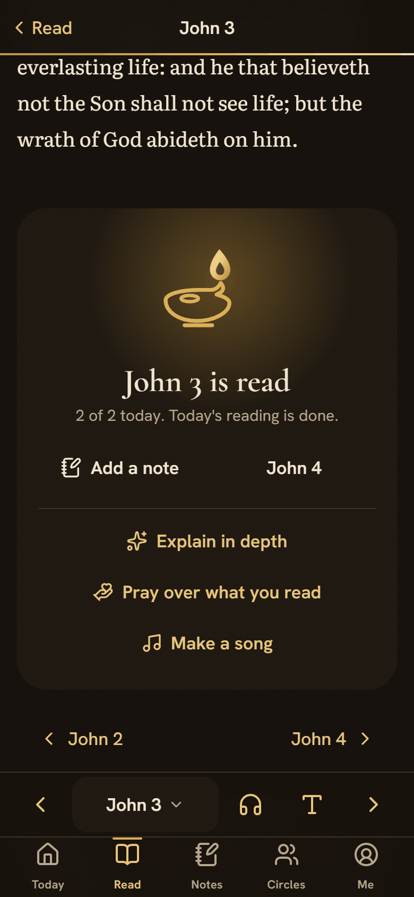</td>
    <td>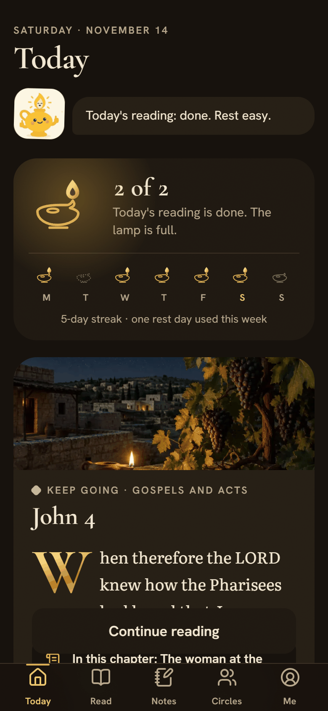</td>
  </tr>
</table>

When you finish a chapter, the mascot cheers you on. You can turn its celebrations off on Me.

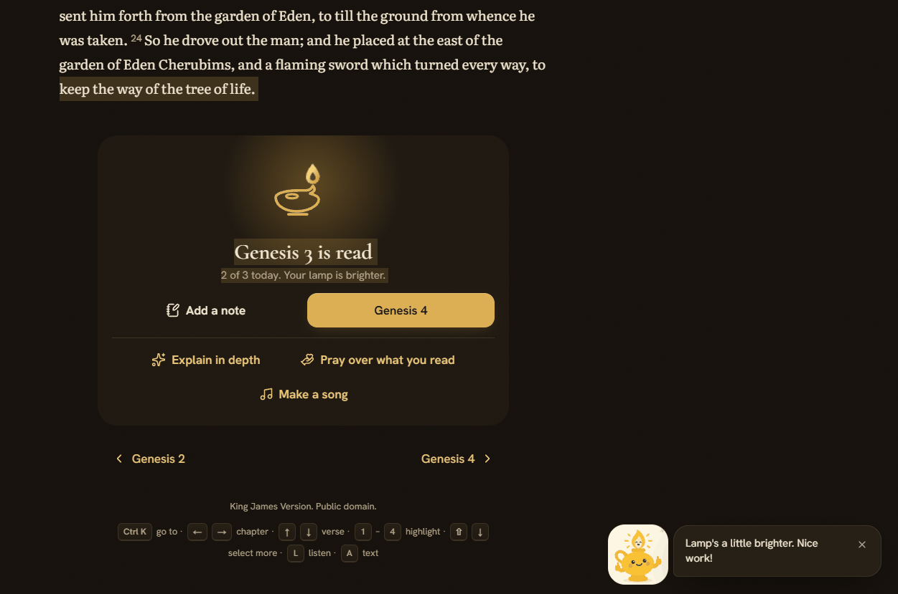

- **Pray** writes a short prayer from the chapters you read recently and always ends "In Jesus' Name, Amen."
- **Make a song:** Claude writes original lyrics from your last three chapters, and ElevenLabs Music sings them in about 70 seconds. You need an account, and you can make three songs a day.

### Circles and the Bible challenge

Circles are private, invite-only groups. See who has read today, send gentle nudges, chat, and share highlights. Messages and nudges show up under the bell and can also be emailed. Tapping a Circle opens its chat at the first message you haven't read.

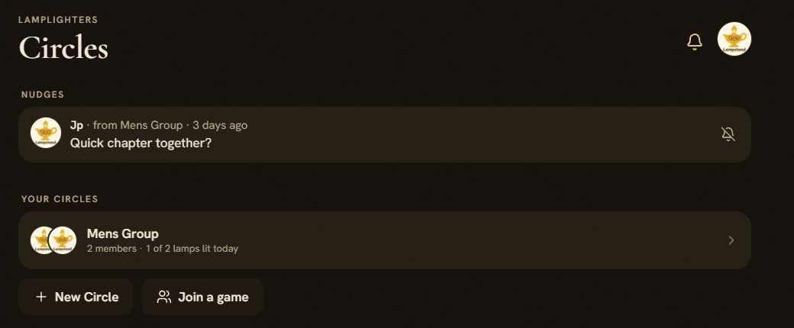

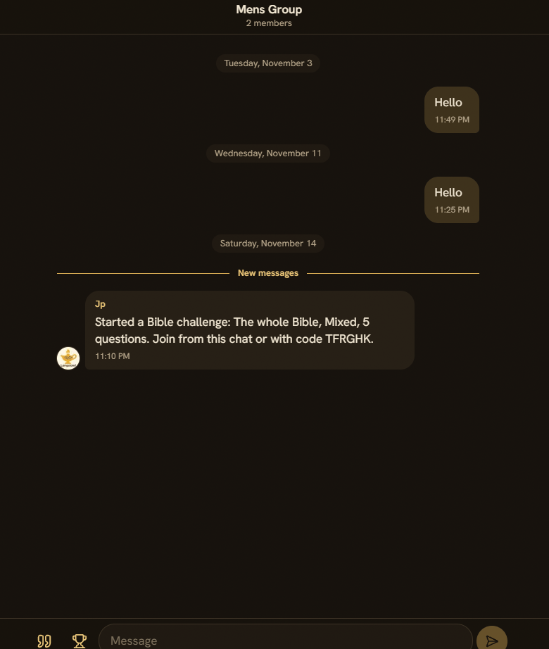

The **Bible challenge** is a quiz your Circle plays together. Start one from the Circle's page or from the trophy in its chat. Host a live game with a join code, a timer, a leaderboard, and a podium, or play the same questions on your own time and compare scores.

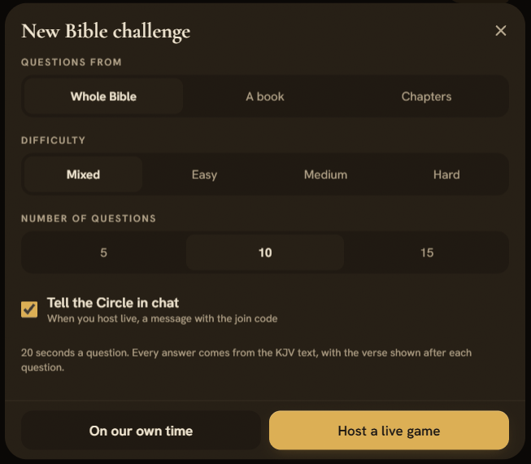

### Guest first

Everything except Circles, songs, and the natural voice works on your device without an account. Signing in syncs your notes, highlights, reading, and settings.

## Run it on your computer

```bash
npm install
npm run dev      # http://localhost:3000 (builds the avatar and mascot images first)
npm test         # about 250 tests: app logic, sync, the paid routes (mocked), and database rules (PGlite)
npm run build    # prerenders all 1,189 KJV chapters
```

1. Copy your keys into `.env.local` (see [Keys and settings](#keys-and-settings)). The app runs without them, with fewer features.
2. Run the Supabase migrations if you want accounts, sync, and Circles (see [Supabase setup](#supabase-setup)).
3. Run `npm run dev` and open http://localhost:3000.

**Test on your phone.** Connect your phone to the same Wi-Fi and open `http://<your computer's address>:3000`, for example `http://192.168.254.100:3000`. Local network addresses (`192.168.*.*` and `10.*.*.*`) are allowed in `next.config.ts`. Restart `npm run dev` after you change that file.

Tests never call Claude, ElevenLabs, or Resend. They use stand-ins, so running them costs nothing.

## Keys and settings

Server keys go in `.env.local`, which is never committed. On Cloud Run, set the same names as service variables or secrets.

```bash
# Bible versions
NLT_API_KEY=...        # New Living Translation, from api.nlt.to (non-commercial: 500 verses a request, 5,000 requests a day)
ESV_API_KEY=...        # English Standard Version, from api.esv.org (non-commercial: 5,000 queries a day, at most 500 verses stored)

# AI
ANTHROPIC_API_KEY=...  # Pray, Explain in depth, highlight summaries, and song lyrics
ELEVENLABS_API_KEY=... # Make a song and the natural voice for Listen (server only)
DAILY_AI_BUDGET_USD=2  # optional: Claude spend per day (UTC) before the AI features pause (default 2)

# Accounts and sync
NEXT_PUBLIC_SUPABASE_URL=...              # public, built into the app
NEXT_PUBLIC_SUPABASE_PUBLISHABLE_KEY=...  # public, built into the app
SUPABASE_SECRET_KEY=...                   # server only: daily limits, saved explanations and summaries, Circle emails, Listen recordings

# Circle emails (optional)
APP_URL=https://your-domain                 # the address used in links inside emails
RESEND_API_KEY=...                          # sends invite, nudge, and message emails through resend.com
EMAIL_FROM="Lampstand <hello@your-domain>"  # a sender on a domain verified in Resend

# Daily limits (optional; UTC days, kept in Supabase so every server shares them)
DAILY_SONG_LIMIT=3              # songs a day for the whole app (default 3); 0 turns songs off
SONG_LIMIT_PER_USER=3           # songs a day per person (default 3)
SONG_LIMIT_PER_IP=6             # songs a day per network address (default 6)
HIGHLIGHT_SUMMARIES_PER_IP=40   # new highlight summaries a day per network address (default 40); saved ones are free
NARRATION_CHAPTERS_PER_DAY=4    # new chapters recorded in the natural voice a day, whole app (default 4); replays are free
NARRATION_CHAPTERS_PER_USER=3   # new chapters recorded a day per person (default 3)
NARRATION_MONTHLY_CHARS=400000  # characters recorded a month, whole app (default 400,000, under the ElevenLabs Creator plan's 550,000 Flash characters)
NARRATION_VOICE_ID=...          # optional: an ElevenLabs voice id (default: the standard "Rachel" voice)

# Network (optional)
TRUSTED_PROXY_HOPS=1            # proxies that add to X-Forwarded-For: 1 on Cloud Run, 2 with a Google load balancer in front
USAGE_HASH_SECRET=...           # the key used to hash network addresses (defaults to one made from SUPABASE_SECRET_KEY)
```

### What happens without a key

| Missing | What readers see |
| --- | --- |
| `ANTHROPIC_API_KEY` | Pray says "Prayer isn't set up on this server yet." Explain in depth works only for chapters already written. Highlights save without a summary. Make a song says "Songs aren't set up on this server yet." |
| `ELEVENLABS_API_KEY` | Make a song says "Songs aren't set up on this server yet," so no lyrics are written or paid for. Listen uses the device voice only. |
| `SUPABASE_SECRET_KEY` | Daily limits count on each server separately. Explanations and summaries are kept in memory only. Circle emails and the natural voice are off. |
| `RESEND_API_KEY`, `EMAIL_FROM`, or `APP_URL` | Invites still work: the inviter copies the link. Nudges and messages are in the app only. |

## What things cost

| Feature | Service | Cost | How it's limited |
| --- | --- | --- | --- |
| Pray, song lyrics | Claude (Sonnet 5.5) | About $0.01 to $0.02 each | `DAILY_AI_BUDGET_USD` |
| Highlight summary | Claude | About $0.0015, written once per verse range for every reader | 10 in 10 minutes and `HIGHLIGHT_SUMMARIES_PER_IP` a day per address, plus the daily budget |
| Make a song | ElevenLabs Music | About 70 seconds of music from your plan | Sign-in, `SONG_LIMIT_PER_USER`, `SONG_LIMIT_PER_IP`, and `DAILY_SONG_LIMIT` |
| Listen, natural voice | ElevenLabs Flash | About $0.04 per 1,000 characters: $0.14 for an average chapter, $0.52 for Psalm 119, once per chapter | Sign-in, `NARRATION_CHAPTERS_PER_USER`, `NARRATION_CHAPTERS_PER_DAY`, and `NARRATION_MONTHLY_CHARS` |
| Listen, device voice | None | Free | None |

- When a limit is reached, the feature says so and rests until the next day or month. Listen switches to the device voice.
- A song or recording that fails doesn't count toward a limit.
- Set a monthly spend limit in the Claude Console and a usage limit in your ElevenLabs account as backstops.
- Highlight summaries work for guests, so each network address has its own cap. That way one stranger can't use up the budget that Pray, Explain, and songs share.

## Supabase setup

Run the migrations in order in the Supabase SQL Editor. A migration that runs successfully says "Success. No rows returned."

| File | Adds |
| --- | --- |
| `0001_init.sql` | Profiles, reading, notes, and highlights, with row-level security |
| `0002_sync.sql` | Settings and tombstones for account sync |
| `0003_feedback.sql` | "Was this helpful?" feedback |
| `0004_ai.sql` | Daily AI spend and saved explanations |
| `0005_lamplighters.sql` | Circles: members, invites, nudges, chat, mutes, and blocks |
| `0006_notifications.sql` | Circle notifications, the "Email me Circle messages" switch, and the email-sent marker |
| `0007_highlight_summaries.sql` | Highlight summaries and the shared `verse_summaries` cache |
| `0008_song_usage.sql` | Song lyrics count toward the daily AI budget |
| `0009_usage_limits.sql` | Daily limits for paid features, shared by every server. Network addresses are stored only as a hash. |
| `0010_notification_email_retry.sql` | A failed Circle message email goes out with the sender's next message |
| `0011_highlight_shares.sql` | Sharing highlights to Circles and the per-Circle auto-share choice |
| `0012_bible_challenge.sql` | The Bible challenge: question bank, sets, live games, players, answers, and scores |
| `0013_narration.sql` | Listen: the list of recorded chapters, the monthly count, and the public `narration` Storage bucket |

The app keeps working when a newer migration hasn't run yet; that feature stays hidden or limited. Run them all before you deploy.

**In the Supabase dashboard**
- **Realtime → Settings:** keep private channels allowed. Chat and live games stream through row-level security, and the typing indicator uses the members-only `circle:<id>` channel.
- **Storage:** check that the public `narration` bucket exists after `0013`. If it doesn't, create it with that name and make it public.
- **Authentication → URL Configuration:** set the Site URL and add `https://your-domain/**` to Redirect URLs. That entry also covers invite links.
- Abuse reports land in the `reports` table (Table Editor). Nobody can read them through the app.

**Sign in with Google.** In Google Cloud, create an OAuth client (APIs & Services → Credentials → Web application) with the redirect URI `https://<project-ref>.supabase.co/auth/v1/callback`. Then in Supabase, go to Authentication → Sign In / Providers → Google, switch it on, and paste the client ID and secret. Until then, the button says Google sign-in isn't switched on.

**Emails from your own address.** Verify your domain in Resend; it adds the DNS records, and with Cloudflare it can add them for you. Then set `EMAIL_FROM="Lampstand <hello@your-domain>"`. Cloudflare Email Routing only receives mail, so replies still reach your inbox. To send Supabase's sign-in emails the same way, use Resend's SMTP in Authentication → Emails → SMTP Settings (host `smtp.resend.com`, port 465, user `resend`, password: your API key).

## Bible content and one-time scripts

Most content ships with the app. Some of it was written once with Claude and checked against the KJV text. The paid scripts never run without an `--estimate` step you can check first.

| Content | Where | Script | Cost |
| --- | --- | --- | --- |
| KJV text | `content/kjv/` | `node scripts/import-kjv.mjs <folder>` | Free |
| Cross-references | `content/xrefs/` | `node scripts/import-xrefs.mjs` | Free |
| "In this chapter" notes | `content/chapters/` | Check with `node scripts/check-chapter-notes.mjs` | Free |
| "In depth" explanations | `content/explanations/` | `npx tsx scripts/generate-explanations.mts` | Paid (Claude) |
| Words of Jesus | `content/speakers/` | `npx tsx scripts/import-speakers.mts <folder>` with the eBible.org USFM files | Free |
| Words of God | `content/speakers/` | `npx tsx scripts/tag-speakers.mts --god` | Paid (Claude) |
| Bible challenge questions | `content/quiz/` | `npx tsx scripts/generate-quiz.mts` | Paid (Claude) |
| Load questions into Supabase | Supabase | `npx tsx scripts/seed-quiz.mts` | Free |

The paid scripts share the same steps:
- `--estimate` shows the cost from the text alone and sends nothing.
- `--sample BOOK.CHAPTER,...` writes a few chapters now, at full price.
- `--batch` sends everything at half price, and `--collect <batch id>` saves the results.

**How the AI content is checked**
- **Speakers:** every passage must appear word for word in its verse and can't overlap the words of Jesus. Results are drafts in `content/speakers/draft-god/` until you run `--approve <BOOK|all> --god`. Today 3,057 passages of God's words and 2,032 of Jesus's words are marked. Six verses of Jesus's words stay uncolored where the two KJV editions spell a word differently; they're listed in `content/speakers/report.json`.
- **Quiz:** a question is played only when its evidence is copied exactly from the verses and its answer comes from that evidence (`lib/quiz/check.ts`). Today 1,198 of 1,242 questions pass, from Genesis, Exodus, the Gospels, and Acts. Read `content/quiz/<BOOK>.md` to review them.
- **Explanations:** every Bible reference is checked against real verse counts (`lib/bible/check-refs.ts`). A pastor or teacher approves them on `/review` (only with `npm run dev`), then you commit `content/explanations` to publish. Copy explanations that readers asked for into review with `npx tsx scripts/pull-explanations.mts` (free).

`content/context-cards.json`, `content/chapters/`, and `content/explanations/` stay `draft` until reviewed.

## Deploying

Before each release:
1. Run any new Supabase migrations.
2. Load new quiz questions with `npx tsx scripts/seed-quiz.mts`, if there are any.
3. Deploy to Cloud Run.

**Cloud Run**
- The two `NEXT_PUBLIC_…` values are built into the app, so pass them as build arguments: `--build-arg NEXT_PUBLIC_SUPABASE_URL=… --build-arg NEXT_PUBLIC_SUPABASE_PUBLISHABLE_KEY=…`.
- Set the server secrets on the service (Secret Manager is best): `ANTHROPIC_API_KEY`, `ELEVENLABS_API_KEY`, `SUPABASE_SECRET_KEY`, `NLT_API_KEY`, `ESV_API_KEY`, `RESEND_API_KEY`, `EMAIL_FROM`, and `APP_URL`. The daily limits are optional.
- Add the live address to Supabase Authentication → URL Configuration.
- Keep a usage limit in your ElevenLabs account and a spend limit in the Claude Console.

## How it works

**Cost protection**
- Daily limits live in Supabase (`usage_counters`), so they hold across restarts and every Cloud Run server.
- The server trusts only the network address Cloud Run adds, not one the browser sends. Addresses are stored only as a keyed hash.
- A song can be recorded only from words the server signed for that person, once. A failed recording can be tried again with the same words.

**Circle notifications**
- The database writes notifications itself (triggers in `0006`), so no browser can create, skip, or fake one.
- A chat message, a shared highlight, or a hosted challenge notifies every other member of the Circle. A nudge notifies the people it reached.
- Mute (the bell-off button on a nudge) stops nudges and message notifications from that person or Circle. Their messages still show in the chat. You can turn it back on from Me.
- Emails go only to people who turned on "Email me nudges" or "Email me Circle messages" on Me, both off by default. Each notification is marked before it's emailed, so a retried request never sends twice. If sending fails, the email goes out with that person's next message in the Circle, within the hour.
- Chat messages go through `/api/lamplighters/message`, so email addresses stay on the server.

**Shared highlights**
- A shared highlight is a chat message that carries the highlight, so membership, mutes, blocks, and emails all apply.
- The server takes the words from the KJV and the verses and color from your highlight, never from the browser.
- Deleting the highlight or changing its verses removes the share. A new color updates it. Leaving a Circle removes your shares there.

**Bible challenge**
- The database keeps the time and the score: 500 points for a right answer, plus up to 500 for speed.
- Answers stay hidden until a question closes. Each player answers once, and late answers earn nothing.
- If a player drops out, they rejoin with the same score. If the host leaves, anyone can close a timed-out question and move on after 45 seconds.

**Listen**
- The device voice reads one verse at a time, in any version.
- The natural voice records a chapter once per voice, stores it in the public `narration` bucket, and replays it for everyone. It reads only the KJV, so licensed text is never sent to ElevenLabs.

## Where things live

**Screens**
- `app/` holds the routes. `(onboarding)` holds welcome, start, and goal. `(tabs)` holds Today, Read, Notes, Circles, and Me, plus plans and streak.
- The reader is at `read/[version]/[book]/[chapter]`, Circle chat at `chat/[id]`, and the Bible challenge at `challenge/[id]` (live) and `challenge/set/[id]` (on your own time).
- `components/ui/` holds the design-system parts. `components/reader/` holds the reader, its sheets, range selection, and the Listen player.
- `components/prayer/`, `components/explain/`, and `components/song/` hold the Pray, Explain in depth, and Make a song sheets, mounted once in `app/layout.tsx`.
- `components/lamplighters/` holds the Circles screens, and `components/quiz/` holds the Bible challenge screens.

**Bible text**
- `lib/bible/` is the version layer. The screens use only `BibleProvider`, so licensed versions plug in as new providers.
- `lib/bible/providers/nlt-api.ts` fetches the NLT a chapter at a time and caches it for days. The NLT notice shows under every NLT chapter and on Me.
- `lib/bible/providers/esv-api.ts` fetches the ESV. Crossway allows at most 500 verses stored, so chapters live in a small in-memory cache. Every page with ESV text shows Crossway's notice and a link to www.esv.org.
- Text that leaves the reader (verse cards, shared highlights, verses on Notes, anything sent to AI or ElevenLabs) is always KJV, so licensed text is never copied. Notes loads its highlighted verses in one request (`app/api/verse/batch`).
- `lib/bible/speakers.ts` holds the speaker colors' logic.

**AI and paid features**
- `lib/ai/budget.ts` holds the daily Claude spend cap, `lib/ai/usage.ts` the daily limits per person, address, and app, and `lib/ai/server.ts` the short burst limits.
- `app/api/prayer/` writes a prayer from recent chapters. Only chapter references are sent, plus an optional intention the reader types.
- `app/api/highlight-summary/` writes a summary from the verses' KJV text only. `lib/highlights/summaries.ts` asks for missing summaries in the background.
- `app/api/song/lyrics/` writes and signs the song. `app/api/song/audio/` records it with ElevenLabs Music and streams the mp3 without storing it. The sound of Praise and Worship is in `lib/song.ts`.
- `app/api/narration/` records and serves the natural voice.
- `lib/explain/examples.ts` holds the model explanation and prayer that set the style. Edit them to change every future explanation and prayer.

**Data and sync**
- `lib/store/` is the on-device store for guest mode. `lib/streak/` and `lib/plans/` hold pure, tested logic.
- `lib/highlights/ranges.ts` holds the rules for multi-verse highlights. They never overlap, and a new color keeps the summary.
- `lib/sync/` syncs the store with your account, and `lib/sync/merge.ts` settles differences between devices.
- `supabase/migrations/` holds the database schema with row-level security.

**Circles**
- `0005_lamplighters.sql` and `0006_notifications.sql` hold every Circle rule in the database. `lib/lamplighters/db.test.ts` and `shares.db.test.ts` run them in PGlite.
- Routes that may send email are in `app/api/lamplighters/`, and the email wording is in `lib/lamplighters/notify-email.ts`.
- `lib/lamplighters/config.ts` holds the limits the screens show. The database cap is `public.circle_member_limit()`.
- `content/mascot.json` holds everything the mascot says and the milestone thresholds. `{count}`, `{days}`, and `{book}` are filled in.

### Adding avatars and mascot images

1. Drop `.png`, `.jpg`, or `.webp` files into `assets/avatars` or `assets/mascot`. Square images of at least 256px (avatars) or 640px (mascot) look best.
2. Run `npm run dev` or `npm run assets`. It makes small WebP copies in `public/lamplighters/` and lists them in `lib/lamplighters/assets.json`.
3. Commit `public/lamplighters/` and `lib/lamplighters/assets.json`. The Docker build doesn't include `assets/` or `scripts/`.

- An avatar's id is its file name in kebab case. Renaming or removing a file sends anyone who chose it back to the default lamp avatar.
- A mascot image's mood comes from its file name: include `cheer`, `wave`, `read`, or `gentle`, for example `lamp-waving.png`. A file without a mood word stands in for any mood.
- For alt text, add `labels.json` next to the images, like `{ "lamp-waving.png": "The lamp waving hello" }`.

## Sources and licenses

- **KJV text:** public domain.
- **Words of Jesus:** the eBible.org King James Version (eng-kjv2006), public domain, from its `\wj` markup.
- **Cross-references:** OpenBible.info, CC BY.
- **NLT:** Tyndale House Publishers, through api.nlt.to under its non-commercial terms. Its notice shows with every NLT chapter.
- **ESV:** Crossway, through api.esv.org under its non-commercial terms. Its notice and a link to www.esv.org show with every ESV chapter.
- **AI-written content** (explanations, summaries, prayers, songs, quiz questions, and speaker tags) is labeled in the app and checked against the KJV text.
